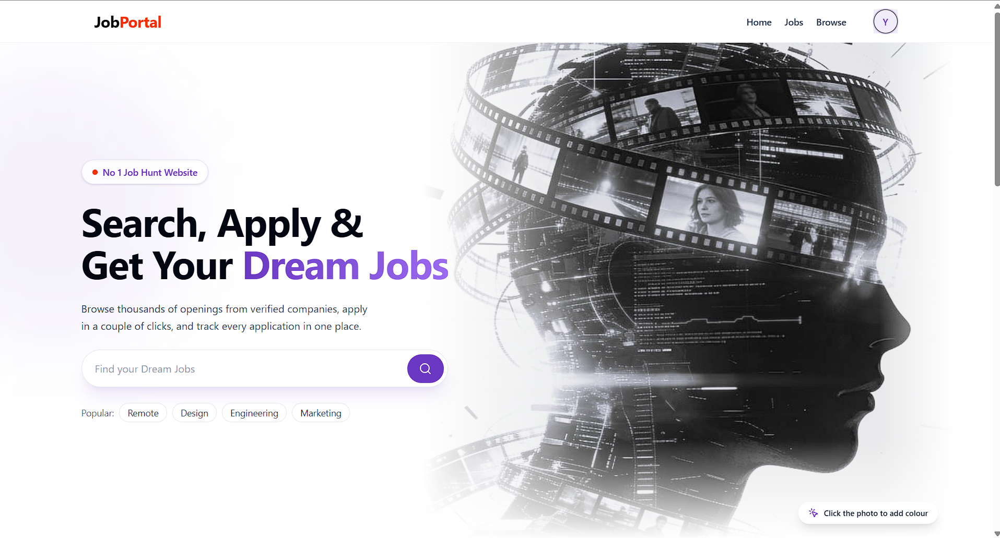

# 💼 Job Portal — MERN Stack Web Application

A full-stack job portal built using the MERN stack that connects job seekers with recruiters. Users can explore job opportunities, search for jobs, apply for positions, and manage their applications. Recruiters can manage companies, publish job openings, and review applicants.

🌐 **Live Website:** [Visit Job Portal](https://job-portal-omega-rust-61.vercel.app)

## 🖼️ Project Preview



## 📌 About the Project

The Job Portal provides a platform for job seekers and recruiters to interact through a centralized recruitment system. It combines a responsive React frontend with a Node.js and Express backend and a MongoDB database.

The application includes authentication, job search, filtering, company management, job applications, and recruiter-side job and applicant management.

## ✨ Features

### 👤 Authentication and User Management
- User registration and login.
- JWT-based authentication.
- Cookie-based authentication.
- Role-based functionality for job seekers and recruiters.
- Secure password hashing.

### 🔍 Job Search and Listings
- Browse available job opportunities.
- Search for jobs using keywords.
- Filter jobs by relevant criteria.
- View job descriptions and requirements.
- Explore job details such as location, salary, and experience requirements.

### 🏢 Company Management
- Create and manage company profiles.
- View and update company information.
- Manage company name, description, location, and website.
- Upload company logos.

### 📄 Job Applications
- Apply for available jobs.
- View submitted applications.
- Track application-related information.
- Manage applications through the portal.

### 🛠️ Recruiter Features
- Create and publish job openings.
- Manage job listings.
- View applicants for posted jobs.
- Access applicant information.
- Update application statuses.

## 🧰 Tech Stack

| Technology | Purpose |
|---|---|
| React.js | Frontend user interface |
| Vite | Development and build tool |
| JavaScript | Application logic |
| Tailwind CSS | UI styling |
| Redux Toolkit | State management |
| React Router | Client-side routing |
| Axios | API communication |
| Node.js | Backend runtime |
| Express.js | REST API development |
| MongoDB | Database |
| Mongoose | MongoDB object modeling |
| JWT | Authentication |
| bcryptjs | Password hashing |
| Multer | File uploads |
| Cloudinary | Cloud image storage |

## 🏗️ Project Structure

```text
job-portal/
├── frontend/
│   ├── public/
│   │   └── assets/
│   │       └── hero-section.png
│   ├── src/
│   │   ├── components/
│   │   ├── pages/
│   │   ├── redux/
│   │   └── utils/
│   ├── package.json
│   └── ...
│
├── backend/
│   ├── controllers/
│   ├── models/
│   ├── routes/
│   ├── middlewares/
│   ├── utils/
│   ├── index.js
│   └── package.json
│
└── README.md
```

*This is a general overview. Keep the actual folder names from your repository when updating this section.*

## ⚙️ Run Locally

### Prerequisites
- Node.js and npm
- MongoDB Atlas account or a local MongoDB instance
- Cloudinary account for image uploads

### 1. Clone the Repository

```bash
git clone YOUR_GITHUB_REPOSITORY_URL
cd job-portal
```

Replace `YOUR_GITHUB_REPOSITORY_URL` with your actual GitHub repository URL.

### 2. Start the Backend

```bash
cd backend
npm install
```

Create a `.env` file in the backend directory using your project's environment-variable configuration.

Configure the required database connection, authentication secret, Cloudinary credentials, and client URL.

Start the backend using the script defined in `backend/package.json`. For example:

```bash
npm run dev
```

### 3. Start the Frontend

Open another terminal:

```bash
cd frontend
npm install
```

Create a `.env` file in the frontend directory and configure the backend API URL:

```env
VITE_API_URL=http://localhost:8000
```

Then start the development server:

```bash
npm run dev
```

Open the local URL shown in your terminal.

## 🔗 API Overview

| API Prefix | Purpose |
|---|---|
| `/api/v1/user` | User authentication and user operations |
| `/api/v1/job` | Job listings and job management |
| `/api/v1/company` | Company management |
| `/api/v1/application` | Job application management |

## 🔐 Security

- Keep database credentials and authentication secrets private.
- Never commit real `.env` files to GitHub.
- Validate incoming requests on the backend.
- Apply role-based authorization to protected operations.
- Use secure authentication and cookie settings.

## 🎯 Learning Outcomes

- Full-stack web development using the MERN stack.
- REST API development and integration.
- React components and routing.
- Redux Toolkit state management.
- Authentication and authorization.
- MongoDB database integration.
- File uploads and cloud storage.
- Environment-variable management.

## 👨‍💻 Developer

**Yash Satpute**

Computer Engineering Student

GitHub: [YashSatpute3142](https://github.com/YashSatpute3142)

---

⭐ If you find this project useful, consider giving the repository a star!
